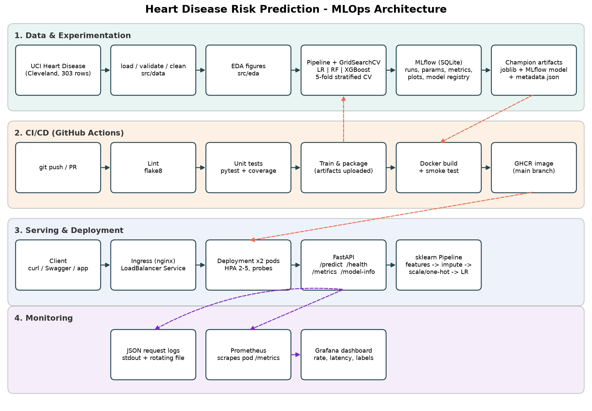

# Heart Disease Risk Prediction — End-to-End MLOps

Predicts the presence of heart disease from 13 clinical attributes (UCI Heart Disease, Cleveland subset) and serves the model as a monitored, containerised REST API deployed to Kubernetes.

| Stage | Implementation |
|---|---|
| Data | Download script → schema/range validation → cleaning → `data/processed/heart_disease_clean.csv` |
| EDA | Histograms, disease rate per category, correlation heatmap, box plots, class balance, missing values |
| Features | `ClinicalFeatureEngineer` (`hr_pct_of_max`) → median/mode imputation → scaling + one-hot (single sklearn `Pipeline`) |
| Models | Logistic Regression, Random Forest, XGBoost tuned with `GridSearchCV` (5-fold stratified, 5 metrics) |
| Tracking | MLflow (SQLite backend): parent run per model + nested run per grid candidate, plots, CV tables, signature, Model Registry alias `champion` |
| Packaging | `joblib` pipeline + MLflow model format + `model_metadata.json`; pinned `requirements*.txt` |
| CI/CD | GitHub Actions: lint → unit tests (coverage gate) → train → Docker build + smoke test → push to GHCR |
| Serving | FastAPI `/predict`, `/predict/batch`, `/health`, `/model-info`, `/metrics` in a non-root Docker image |
| Deployment | Kubernetes manifests (Deployment, LoadBalancer Service, Ingress, HPA, ConfigMap) for Docker Desktop / Minikube |
| Monitoring | Structured JSON request logs + Prometheus metrics + provisioned Grafana dashboard |



---

## Repository layout

```text
heart-disease-mlops/
├── .github/workflows/ci.yml       # CI/CD pipeline
├── dags/heart_disease_pipeline.py # Airflow orchestration
├── data/
│   ├── raw/                       # downloaded UCI file (git-ignored, reproducible)
│   └── processed/                 # cleaned dataset + data quality report
├── k8s/                           # Namespace, ConfigMap, Deployment, Service, Ingress, HPA, kustomization
│   └── monitoring/                # in-cluster Prometheus + Grafana
├── models/                        # champion: joblib pipeline, metadata, MLflow model
├── monitoring/                    # Prometheus config + Grafana provisioning & dashboard (docker compose)
├── notebooks/                     # 01_eda, 02_model_training, 03_inference (executed, with outputs)
├── reports/                       # submitted Word report, REPORT.md, model comparison, EDA summaries
├── screenshots/                   # architecture.png, EDA/, models/, operational evidence
├── scripts/                       # download, smoke test, traffic generator, k8s deploy, pipeline runners
├── src/
│   ├── config.py                  # paths, column groups, experiment settings
│   ├── data/                      # load_data, validate_data, clean_data
│   ├── eda/                       # run_eda
│   ├── features/                  # feature_engineering, prepare_data (preprocessing pipeline)
│   ├── models/                    # model_pipelines, train_models, evaluate_models, persistence, train (orchestrator)
│   ├── tracking/                  # mlflow_tracking, select_champion, register_model
│   ├── inference/                 # predict (shared by API + batch scoring)
│   ├── monitoring/                # Prometheus metrics, JSON logging
│   └── api/                       # FastAPI app + pydantic schemas
├── tests/                         # pytest: data, features, models, tracking, API
├── Dockerfile, .dockerignore, docker-compose.yml
├── requirements.txt               # full environment (pinned)
└── requirements-serve.txt         # minimal serving runtime (pinned, same versions)
```

---

## 1. Setup (clean environment)

Requires Python 3.13 (3.12 also works). Docker Desktop and `kubectl` are needed only for the container / Kubernetes steps.

```powershell
# Windows PowerShell
python -m venv .venv
.\.venv\Scripts\Activate.ps1
python -m pip install -r requirements.txt
```

```bash
# Linux / macOS / WSL  (or: uv venv && uv pip install -r requirements.txt)
python3 -m venv .venv && source .venv/bin/activate
pip install -r requirements.txt
```

One-shot reproduction of everything below: `./scripts/run_pipeline.ps1` (Windows) or `./scripts/run_pipeline.sh` (Linux / WSL).

### Running in WSL (Ubuntu)

```bash
cd /mnt/d/BITS/Semester-3/MLOps/MLOPS_Webinar1/heart-disease-mlops   # or a clone under ~ (much faster I/O)
./scripts/run_pipeline.sh            # creates .venv-linux with uv (Python 3.13), installs, lints, tests, trains
source .venv-linux/bin/activate      # afterwards, for manual commands
uvicorn src.api.main:app --host 0.0.0.0 --port 8000   # reachable from Windows at http://localhost:8000/docs
```

- The script uses its own `.venv-linux` because a Windows `.venv` (with `Scripts\` instead of `bin/`) cannot be activated from Linux.
- It prefers `uv` (as in the Webinar 1 lab), which downloads Python 3.13 even if the distro only ships 3.14 or lacks `python3-venv`.
- On a Windows drive (`/mnt/c`, `/mnt/d`, ...) it keeps a separate MLflow store (`mlflow-linux.db`, `mlruns-linux/`), because a Windows-created `mlflow.db` stores `file:///D:/...` artifact paths that Linux cannot write to.
- `.gitattributes` forces LF endings for `*.sh`. If you see `$'\r': command not found`, run `sed -i 's/\r$//' scripts/*.sh`.

## 2. Data acquisition & EDA

```bash
python scripts/download_data.py        # downloads processed.cleveland.data and writes the cleaned CSV
python -m src.eda.run_eda              # figures -> screenshots/EDA/, summaries -> reports/
```

Source: <https://archive.ics.uci.edu/dataset/45/heart+disease> (`processed.cleveland.data`, 303 rows, 14 columns).

## 3. Train, evaluate and track

```bash
python -m src.models.train             # full grid search + MLflow tracking + registry
python -m src.models.train --quick     # 1-point grids (fast smoke run)
mlflow ui --backend-store-uri sqlite:///mlflow.db --port 5000   # http://127.0.0.1:5000
```

Outputs: `models/heart_disease_model.joblib`, `models/model_metadata.json`, `models/mlflow_model/`, `reports/model_comparison.{csv,md}`, `screenshots/models/*.png`, MLflow runs in `mlflow.db` + `mlruns/`, registered model `HeartDiseaseRiskChampion@champion`.

Batch scoring with the packaged model:

```bash
python -m src.inference.predict        # -> data/processed/batch_predictions.csv
```

## 4. Tests & lint

```bash
flake8 src tests scripts dags
pytest --cov=src --cov-report=term-missing
```

Tests use synthetic data and temporary MLflow stores, so they need no network access or pre-trained model.

## 5. Run the API

```bash
uvicorn src.api.main:app --port 8000     # Swagger UI: http://127.0.0.1:8000/docs
python scripts/smoke_test.py --url http://127.0.0.1:8000
```

```bash
curl -X POST http://127.0.0.1:8000/predict -H "Content-Type: application/json" -d @scripts/sample_request.json
```

```json
{"prediction":0,"label":"no_heart_disease","confidence":0.7385,"probability_heart_disease":0.2615,
 "risk_level":"low","model_version":"3","request_id":"a8f8b076a3b1"}
```

| Endpoint | Method | Purpose |
|---|---|---|
| `/predict` | POST | One patient → prediction, confidence, probability, risk band |
| `/predict/batch` | POST | Up to 500 patients |
| `/health` | GET | Liveness/readiness (503 if model not loaded) |
| `/model-info` | GET | Version, params, CV + test metrics |
| `/metrics` | GET | Prometheus exposition |

Input validation (pydantic): clinically plausible ranges, allowed category codes, unknown fields rejected (HTTP 422). `ca` and `thal` are optional and imputed by the pipeline.

## 6. Docker

```bash
docker build -t heart-disease-api:1.0.0 .
docker run --rm -p 8000:8000 heart-disease-api:1.0.0
python scripts/smoke_test.py --url http://127.0.0.1:8000
```

Full local stack with monitoring:

```bash
docker compose up --build -d
python scripts/generate_traffic.py --requests 300
# API http://localhost:8000/docs | Prometheus http://localhost:9090 | Grafana http://localhost:3000 (admin/admin)
```

## 7. Kubernetes (Docker Desktop or Minikube)

```powershell
./scripts/deploy_k8s.ps1 -Target docker-desktop     # or -Target minikube
```

On Linux (including a remote university machine):

```bash
bash scripts/deploy_k8s.sh minikube
```

The Bash script requires Docker access and Minikube on PATH, not a Python virtual
environment. It creates or starts the default `minikube` profile using the Docker
driver (2 CPUs, 4096 MB), enables ingress and metrics-server, builds the image, and
deploys the API, Prometheus and Grafana. If standalone `kubectl` is unavailable,
it uses Minikube's bundled client. All deployment commands target the selected
cluster explicitly. Existing profiles must be compatible with these settings.
On shared machines, obtain permission before allocating cluster resources.

The script waits for all three deployments and prints localhost port-forward
commands. Run each in a separate terminal. For a remote host, also run this on
your laptop (replace `USER@HOST` with your SSH login):

```bash
ssh -N -o ExitOnForwardFailure=yes -L 8000:127.0.0.1:8000 -L 9090:127.0.0.1:9090 -L 3000:127.0.0.1:3000 USER@HOST
```

Then open `http://localhost:8000/docs`, `http://localhost:9090`, and
`http://localhost:3000` on your laptop. Keep the SSH tunnel and port-forwards
running; do not expose them using `--address=0.0.0.0`.

or manually:

```bash
docker build -t heart-disease-api:1.0.0 .            # (minikube: eval $(minikube docker-env) first)
kubectl apply -k k8s/
kubectl apply -f k8s/monitoring/prometheus.yaml
kubectl create configmap grafana-dashboards -n heart-disease --from-file=monitoring/grafana/dashboards/
kubectl apply -f k8s/monitoring/grafana.yaml
kubectl get pods,svc,ingress,hpa -n heart-disease
```

Access:

| Cluster | API URL |
|---|---|
| Docker Desktop | `http://localhost/docs` (LoadBalancer on port 80) |
| Minikube | `minikube tunnel` then the service EXTERNAL-IP, or `minikube service heart-disease-api -n heart-disease --url` |
| Ingress | add `<ingress-ip> heart-disease.local` to the hosts file → `http://heart-disease.local/docs` |

Prometheus: NodePort `30090`, Grafana: NodePort `30030` (admin/admin) → dashboard **MLOps / Heart Disease API**.

## 8. CI/CD

`.github/workflows/ci.yml` runs on every push/PR:

1. **Lint** – flake8 (report uploaded)
2. **Unit tests** – pytest with coverage gate ≥ 75 % (JUnit + coverage XML uploaded, summary in job page)
3. **Train** – download → EDA → train/track/register → batch inference (model, reports, MLflow store, logs uploaded; model comparison in job summary)
4. **Docker** – build the image with the freshly trained model, run it, smoke test all endpoints, upload container logs; on `main` push to `ghcr.io/<owner>/heart-disease-api`

Each job depends on the previous one and uses `bash -eo pipefail`, so any lint, test, training or smoke-test failure stops the pipeline with a clear log.

## Report

See [reports/REPORT.md](reports/REPORT.md) 
Repository link: <https://github.com/2025ae05770-cpu/heart-disease-mlops>.
