# Heart Disease Risk Prediction: End-to-End MLOps Pipeline

**Course:** Machine Learning Operations (AIMLCZG523), Assignment 1

**Student:** Puneet Chawla (2025AE05770)

**Code repository:** <https://github.com/2025ae05770-cpu/heart-disease-mlops>

**Deployed API / access:** local Kubernetes (Docker Desktop / Minikube). See Section 9 for access instructions.

## 1. Executive Summary

This project builds a heart-disease risk classifier from the UCI Heart Disease (Cleveland) dataset and runs it as a reproducible, tested, containerised and monitored REST API. The workflow has four parts:

- **Experimentation:** a download script, schema validation, cleaning, EDA, a single scikit-learn pipeline (domain feature, imputation, scaling and one-hot encoding), three tuned model families, and 5-fold cross-validation scored on five metrics.
- **Tracking and packaging:** every grid candidate is logged to MLflow, and the champion is registered with the `champion` alias. The model is exported as a joblib pipeline and in MLflow format, alongside pinned requirements.
- **Automation:** GitHub Actions runs lint, unit tests (44 tests, 87% coverage), training and a Docker build with a smoke test. The pipeline stops on the first failure.
- **Operations:** a FastAPI service runs in a non-root container, deployed to Kubernetes with probes, an HPA, a LoadBalancer and an Ingress. It writes JSON request logs and exposes Prometheus metrics, which feed a provisioned Grafana dashboard.

The champion is **Logistic Regression** (C = 0.5, balanced class weights). It scored **CV ROC-AUC 0.909 ± 0.018** and **hold-out ROC-AUC 0.958**, with recall 0.929 on the hold-out set.

## 2. Architecture


| Layer | Tools | Key files |
|---|---|---|
| Data & EDA | pandas, requests, seaborn | `src/data/*`, `src/eda/run_eda.py`, `scripts/download_data.py` |
| Features & models | scikit-learn, XGBoost | `src/features/*`, `src/models/*` |
| Tracking & registry | MLflow 3 (SQLite backend) | `src/tracking/*`, `mlflow.db`, `mlruns/` |
| Serving | FastAPI, uvicorn, pydantic | `src/api/*`, `src/inference/predict.py` |
| Packaging | joblib, MLflow model, Docker | `models/`, `Dockerfile`, `requirements*.txt` |
| CI/CD | GitHub Actions, GHCR | `.github/workflows/ci.yml` |
| Deployment | Kubernetes, Kustomize | `k8s/*.yaml`, `scripts/deploy_k8s.*` |
| Monitoring | prometheus_client, Prometheus, Grafana | `src/monitoring/*`, `monitoring/`, `k8s/monitoring/` |
| Orchestration | Airflow (optional) | `dags/heart_disease_pipeline.py` |

The design follows the Webinar 1 pattern. The notebooks only orchestrate, and all logic lives in importable `src/` modules. As a result, the notebooks, the training command-line tool, the Airflow DAG, the CI pipeline and the API all run the same code.

## 3. Setup and Installation

1. Clone the repository and create an environment: `python -m venv .venv`, then activate it.
2. Install the pinned dependencies with `pip install -r requirements.txt` (Python 3.13; 3.12 also works).
3. Reproduce everything with `./scripts/run_pipeline.ps1` on Windows or `./scripts/run_pipeline.sh` on Linux/WSL. The script runs lint, tests, download, EDA, training and batch inference.
4. Open the MLflow UI with `mlflow ui --backend-store-uri sqlite:///mlflow.db --port 5000`.
5. Start the API with `uvicorn src.api.main:app --port 8000`, or with `docker compose up --build` to include Prometheus and Grafana.

`requirements.txt` pins every direct dependency. `requirements-serve.txt` pins the minimal runtime with identical versions, so the pickled pipeline loads the same way inside the container. I confirmed this by installing only `requirements-serve.txt` into a fresh virtual environment and passing all 7 smoke-test checks against it.

## 4. Data Acquisition and EDA

**Source:** `processed.cleveland.data` from the UCI Machine Learning Repository: 303 patients, 13 features and a diagnosis `num` from 0 to 4. `scripts/download_data.py` (equivalently, `python -m src.data.load_data`) downloads the file only if it is missing, then cleans and validates it.

**Cleaning decisions** (`src/data/clean_data.py`):

- The file is headerless, so column names are supplied; `?` placeholders are converted to NaN and all columns are coerced to numeric.
- The diagnosis `num` (0 to 4) is collapsed into a binary `target`: 0 = absent, 1 = present (any of `num` 1 to 4).
- Duplicates are dropped (none found). Clinical range checks report out-of-range values (none found) and write them to `data_quality_report.json`.
- Six missing values remain (`ca` 4, `thal` 2). They are kept in the cleaned CSV on purpose and imputed inside the model pipeline. This keeps imputation statistics fold-local during CV, which avoids leakage, and makes serving apply exactly the same step.

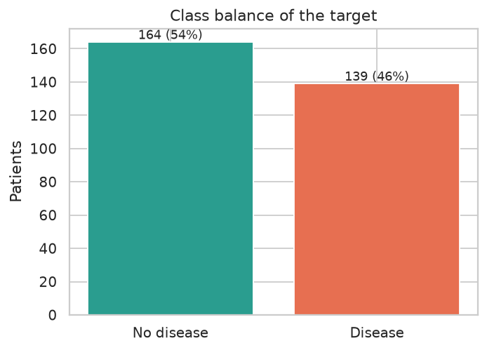
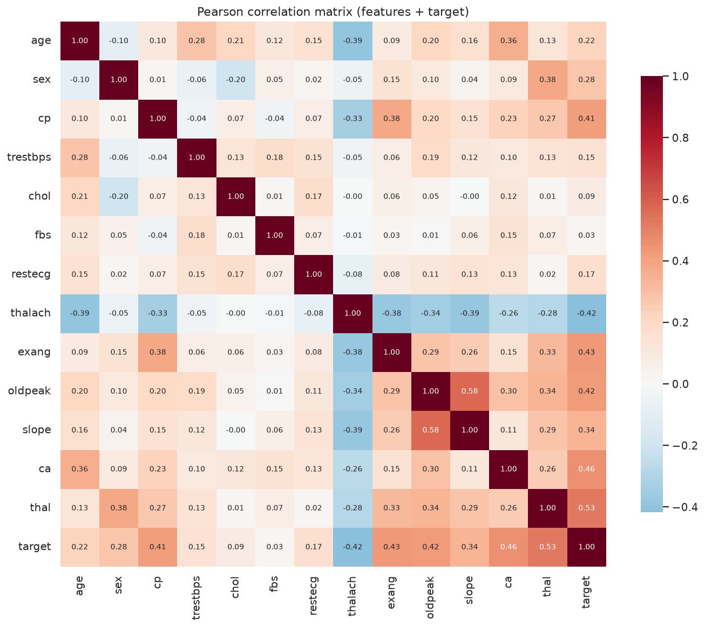

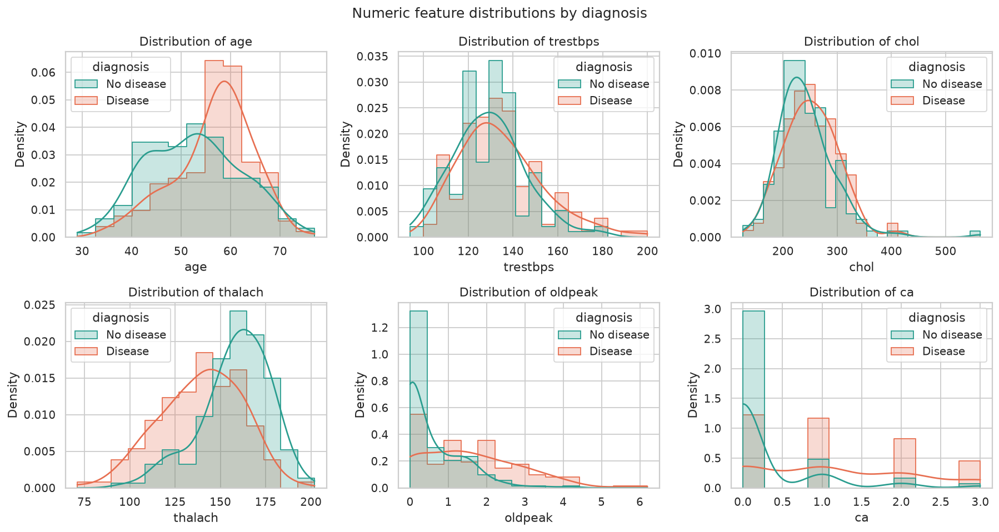

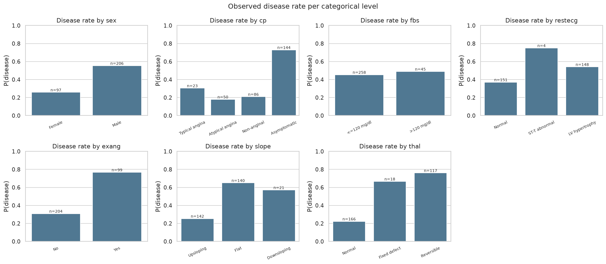

**Key findings and their impact on modelling:**

| Finding | Modelling decision |
|---|---|
| Mild imbalance (54/46) | Stratified split and CV; tune `class_weight`; report recall and ROC-AUC, not only accuracy |
| Strongest target correlations: `thal` 0.53, `ca` 0.46, `exang` 0.43, `oldpeak` 0.43, `thalach` -0.42, `cp` 0.41 | All features kept; the regularisation strength `C` is tuned |
| `cp`, `restecg`, `slope`, `thal` are nominal codes (for example, asymptomatic chest pain has a 73% disease rate) | One-hot encode instead of treating codes as numbers |
| `thalach` falls with age | Engineered `hr_pct_of_max = thalach / (220 - age)` |
| Scales differ by about 100x and `chol` has outliers (up to 564) | Standardise numeric features, which matters for the linear model |
| `chol` and `fbs` correlate weakly with the target | Kept, with the effect left to regularisation and the trees to judge |

## 5. Feature Engineering and Model Development

**Preprocessing pipeline** (`src/features/prepare_data.py`). One sklearn `Pipeline` holds every transformation, so the same object runs in CV, on the test set and inside the API:

1. `ClinicalFeatureEngineer`, a custom transformer, adds `hr_pct_of_max`, the share of the age-predicted maximum heart rate reached during exercise. A low value (chronotropic incompetence) is a known cardiac risk marker.
2. Numeric columns (`age`, `trestbps`, `chol`, `thalach`, `oldpeak`, `ca`, `hr_pct_of_max`) get a median imputer, then a `StandardScaler`.
3. Categorical columns (`sex`, `cp`, `fbs`, `restecg`, `exang`, `slope`, `thal`) get a most-frequent imputer, then a `OneHotEncoder` with `drop="if_binary"` and `handle_unknown="ignore"`.

The output is 23 model features.

**Models and tuning** (`src/models/model_pipelines.py`, `src/models/train_models.py`). The data is split 80/20 with stratification (242 training rows, 61 test rows). Each family is tuned with `GridSearchCV` using `StratifiedKFold(5, shuffle=True, random_state=42)`. Every candidate is scored on accuracy, precision, recall, F1 and ROC-AUC, and the best candidate is refit on ROC-AUC.

| Model | Grid searched | Candidates | Best parameters |
|---|---|---|---|
| Logistic Regression | C ∈ {0.01, 0.1, 0.5, 1, 5} × class_weight ∈ {None, balanced} | 10 | C = 0.5, class_weight = balanced |
| Random Forest | n_estimators ∈ {200, 500} × max_depth ∈ {None, 4, 8} × min_samples_leaf ∈ {1, 4} | 12 | 500 trees, max_depth None, min_samples_leaf 4 |
| XGBoost | n_estimators ∈ {100, 300} × max_depth ∈ {2, 3} × learning_rate ∈ {0.03, 0.1}; subsample and colsample = 0.8 | 8 | 100 trees, depth 2, learning rate 0.03 |

**Results** (CV columns are the mean of 5 folds on the training split; test columns are the 61-row hold-out set):

| Model | CV acc | CV prec | CV recall | CV F1 | CV ROC-AUC | Test acc | Test prec | Test recall | Test F1 | Test ROC-AUC |
|---|---|---|---|---|---|---|---|---|---|---|
| **Logistic Regression** | **0.855** | **0.875** | **0.810** | **0.837** | **0.909 ± 0.018** | 0.869 | 0.812 | 0.929 | 0.867 | **0.958** |
| Random Forest | 0.818 | 0.839 | 0.764 | 0.792 | 0.898 ± 0.028 | 0.885 | 0.839 | 0.929 | 0.881 | 0.950 |
| XGBoost | 0.826 | 0.838 | 0.783 | 0.803 | 0.894 ± 0.024 | 0.902 | 0.867 | 0.929 | 0.897 | 0.957 |

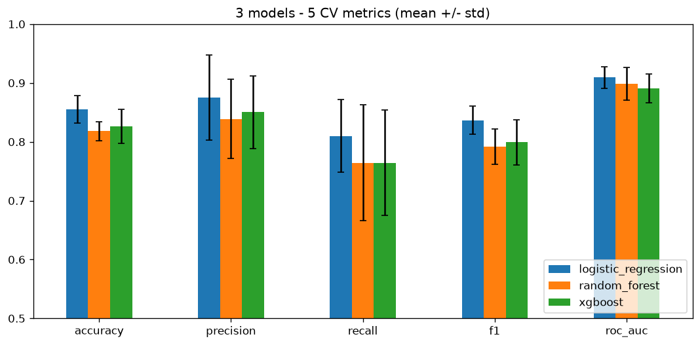
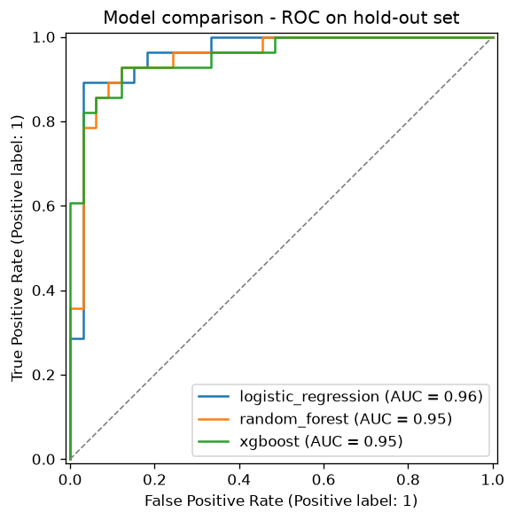

**Model selection rationale** (`src/tracking/select_champion.py`):

- The primary criterion is **mean CV ROC-AUC**. It does not depend on a decision threshold, and it averages 5 folds of about 48 rows each, so it is far more stable than a single 61-row hold-out set, where one patient moves accuracy by 1.6 points. Ties are broken by test recall, because missing a sick patient is the costlier error.
- Logistic Regression has the best CV score on every metric and the lowest variance. The tree ensembles have slightly higher hold-out accuracy but lower CV scores, which points to hold-out noise rather than genuinely better performance. The small dataset (303 rows) also favours a well-regularised linear model over high-variance ensembles.
- Logistic Regression is also interpretable, and it is small and fast to serve. Its largest coefficients are `sex`, `ca`, `cp = 4` (asymptomatic) and `thal = 7` (reversible defect), which is clinically plausible.

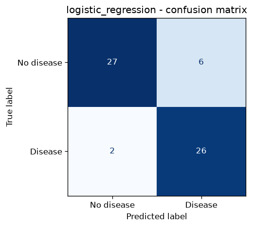
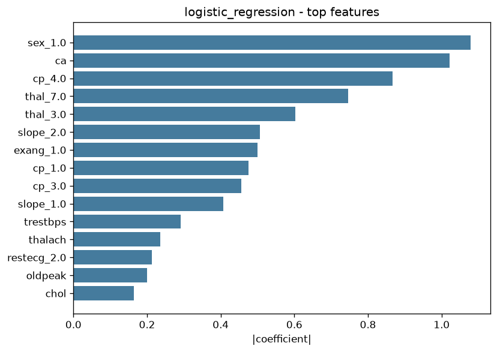

## 6. Experiment Tracking (MLflow)

`src/tracking/mlflow_tracking.py` uses a SQLite backend (`mlflow.db`) with file artifacts (`mlruns/`), following the class convention. Each training run produces:

- **One parent run per model family**, which logs:
  - the best hyperparameters, plus data and CV settings (rows, folds, grid size, refit metric, random state);
  - the mean and standard deviation of all five CV metrics, and the five test metrics;
  - plots (confusion matrix, ROC/PR curves, feature importance) and the full `cv_results_` CSV;
  - the training dataset as an MLflow dataset input;
  - the model with an inferred signature, an input example and the bundled `src/` code, so the custom transformer loads anywhere.
- **One nested child run per grid candidate (30 in total)**, with its parameters, the CV mean of each metric and its rank. Every configuration tried can be compared in the UI.
- **A `model-comparison` run**, which stores the comparison table and plots and tags the champion.
- **A registry entry**: the champion is registered as `HeartDiseaseRiskChampion`, a new version per training run, with the alias `@champion` and tags for model family and CV ROC-AUC.

Three training runs (CLI, notebook and re-run) produced identical metrics and registry versions 1 to 3, which confirms that training is reproducible end to end.

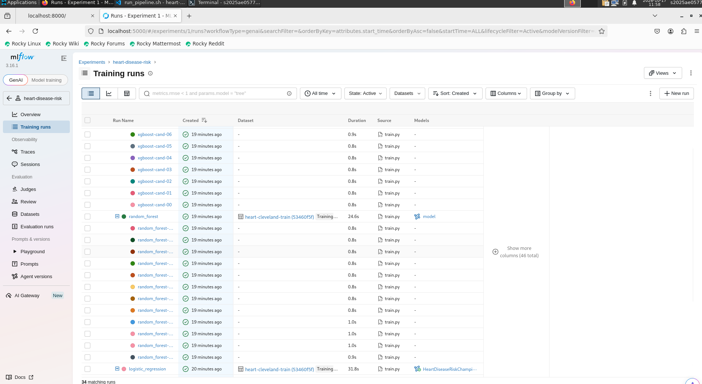
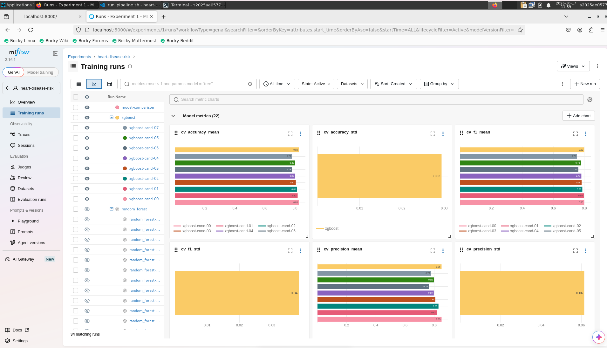
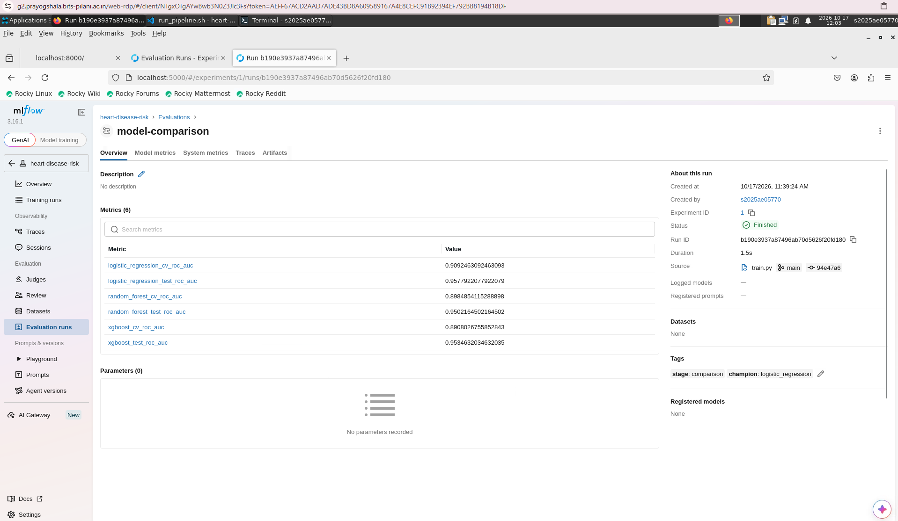
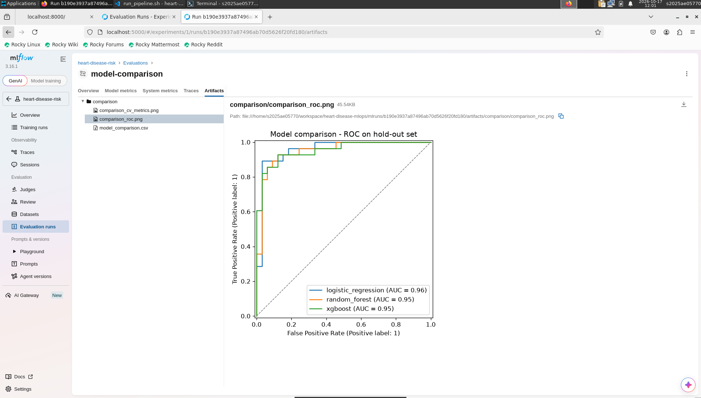
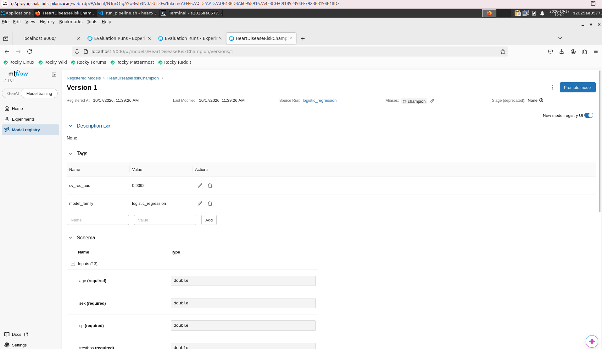

## 7. Model Packaging and Reproducibility

| Artifact | Purpose |
|---|---|
| `models/heart_disease_model.joblib` | The full sklearn pipeline (feature engineering, preprocessing and classifier); loaded by the API |
| `models/model_metadata.json` | Version, training time, parameters, CV and test metrics, feature list, threshold, Python and sklearn versions, MLflow run ID |
| `models/mlflow_model/` | MLflow format (`MLmodel`, `model.pkl`, `conda.yaml`, `python_env.yaml`, `requirements.txt`, signature, input example, bundled code), servable with `mlflow models serve` |
| `requirements.txt` / `requirements-serve.txt` | Pinned full environment and pinned minimal runtime |

Reproducibility comes from fixed seeds (`random_state = 42`) for the split, CV folds and every model; configuration in one place (`src/config.py`); preprocessing fitted inside the pipeline, so there is no training/serving skew; and pinned dependency versions.

Loading `models/mlflow_model` with `mlflow.pyfunc` and loading `models:/HeartDiseaseRiskChampion@champion` both return the same prediction as the joblib model. Batch scoring (`python -m src.inference.predict`) writes `data/processed/batch_predictions.csv`.

## 8. CI/CD Pipeline and Automated Testing

**Unit tests** (`tests/`, pytest, 44 tests, 87% line coverage) run on synthetic patients and temporary MLflow stores, so they need neither network access nor a pre-trained model:

| File | What it covers |
|---|---|
| `test_data.py` | Headerless parsing, `?` to NaN, target binarisation, duplicate removal, validation errors (missing columns, bad target, empty data), mocked download |
| `test_features.py` | The engineered feature formula, stratified split, no NaN after preprocessing, scaling to zero mean and unit variance, one-hot names, unseen categories |
| `test_models.py` | Model specs, CV summary keys, metrics, champion selection and tie-break, risk bands, the prediction output contract, batch inference, end-to-end `run_training` |
| `test_tracking.py` | MLflow parent run parameters, metrics and artifacts, nested child runs, registry alias, reloading the logged model |
| `test_api.py` | `/health`, `/predict` response contract, optional fields, 422 on invalid or unknown input, batch, `/metrics`, request log file, 503 when the model is missing |

**GitHub Actions** (`.github/workflows/ci.yml`) runs on every push and pull request. Its four jobs are chained with `needs`, so a failure stops all later jobs, and every step runs under `bash -eo pipefail`:

1. **Lint:** `flake8` over `src`, `tests`, `scripts` and `dags`; the report is uploaded as an artifact.
2. **Unit tests:** `pytest` with JUnit XML and a coverage XML report, plus a coverage gate of at least 75%. Results are uploaded and summarised on the run page.
3. **Train:** download, EDA, training with MLflow tracking and registration, then batch inference. The model, reports, `mlflow.db`, `mlruns/`, logs and processed data are uploaded, and the model comparison table is written to the job summary.
4. **Docker:** builds the image from the model trained in step 3, runs the container, and smoke-tests `/health`, three `/predict` cases, the 422 path, `/predict/batch` and `/metrics`. Container logs are uploaded. On `main`, the image is pushed to `ghcr.io/<owner>/heart-disease-api`.

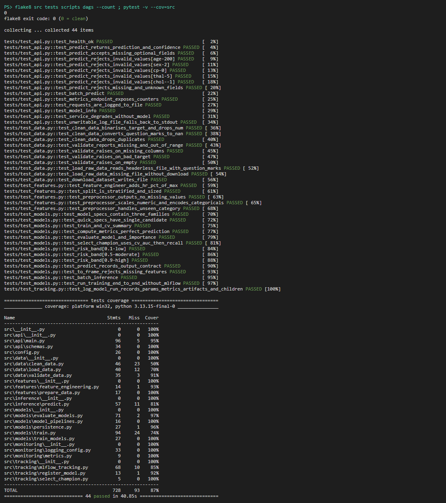
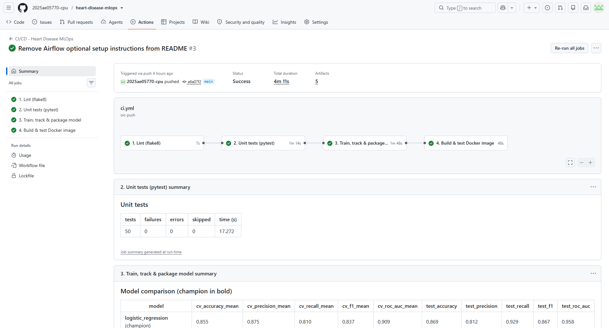

## 9. Containerisation, Deployment and API

**API** (`src/api/main.py`, FastAPI):

- **Endpoints:** `POST /predict` (one patient), `POST /predict/batch` (up to 500 patients), `GET /health`, `GET /model-info`, `GET /metrics`, and an interactive Swagger UI at `/docs`.
- **Input validation:** a pydantic schema enforces clinical ranges and allowed codes (for example `cp` ∈ {1, 2, 3, 4} and `thal` ∈ {3, 6, 7}) and rejects unknown fields with HTTP 422. `ca` and `thal` are optional and are imputed.
- **Response:** `prediction` (0 or 1), `label`, `confidence` (the probability of the predicted class), `probability_heart_disease`, `risk_level` (low below 0.35, moderate below 0.65, high otherwise), `model_version` and `request_id`. The request ID is also returned in the `X-Request-ID` header.

```json
POST /predict  {"age":63,"sex":1,"cp":1,"trestbps":145,"chol":233,"fbs":1,"restecg":2,
                "thalach":150,"exang":0,"oldpeak":2.3,"slope":3,"ca":0,"thal":6}
200 OK         {"prediction":0,"label":"no_heart_disease","confidence":0.7385,
                "probability_heart_disease":0.2615,"risk_level":"low","model_version":"3",
                "request_id":"3965b220b029"}
```

**Docker** (`Dockerfile`):

- Single stage on `python:3.13-slim`, installing only `requirements-serve.txt` (with the CPU-only XGBoost wheel), `src/` and the model files.
- Runs as a non-root user (UID 10001), with a `HEALTHCHECK` on `/health`. `uvicorn` listens on port 8000.
- `.dockerignore` keeps data, notebooks, tests and MLflow stores out of the image.

Build and run with `docker build -t heart-disease-api:1.0.0 .` and `docker run -p 8000:8000 heart-disease-api:1.0.0`, then check with `python scripts/smoke_test.py`.

**Kubernetes** (`k8s/`, applied with `kubectl apply -k k8s/` or `scripts/deploy_k8s.ps1`):

- **Namespace** `heart-disease`, plus a **ConfigMap** for the model path and log settings.
- **Deployment:**
  - 2 replicas, with a rolling update that keeps 0 pods unavailable;
  - startup, readiness and liveness probes on `/health`;
  - CPU and memory requests and limits;
  - a security context with non-root user, read-only root filesystem and all capabilities dropped (`emptyDir` volumes for logs and `/tmp`);
  - Prometheus scrape annotations.
- **Service** of type `LoadBalancer` (port 80 to 8000), an nginx **Ingress** for host `heart-disease.local`, and an **HPA** that scales from 2 to 5 replicas at 70% CPU.

| Cluster | Access |
|---|---|
| Docker Desktop | `http://localhost/docs`, `python scripts/smoke_test.py --url http://localhost` |
| Minikube | `minikube tunnel`, then the EXTERNAL-IP, or `minikube service heart-disease-api -n heart-disease --url` |
| Ingress | Hosts entry `<ingress-ip> heart-disease.local`, then `http://heart-disease.local/docs` |

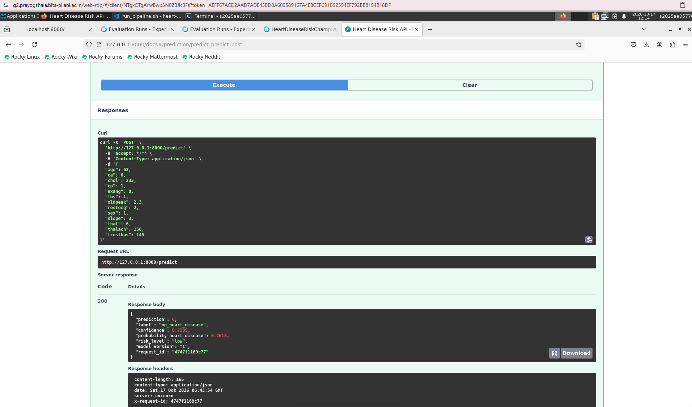
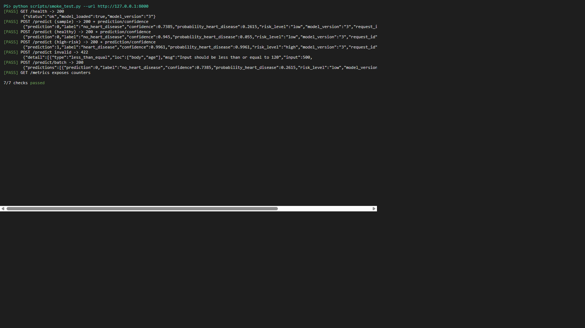
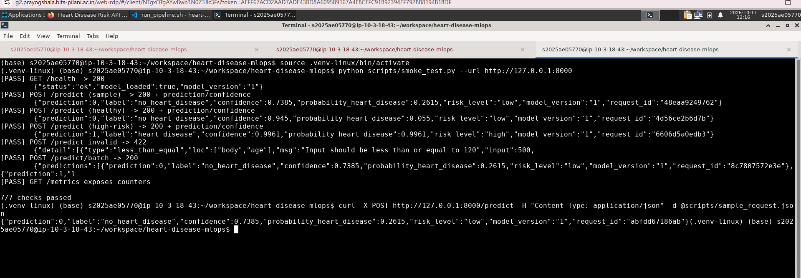
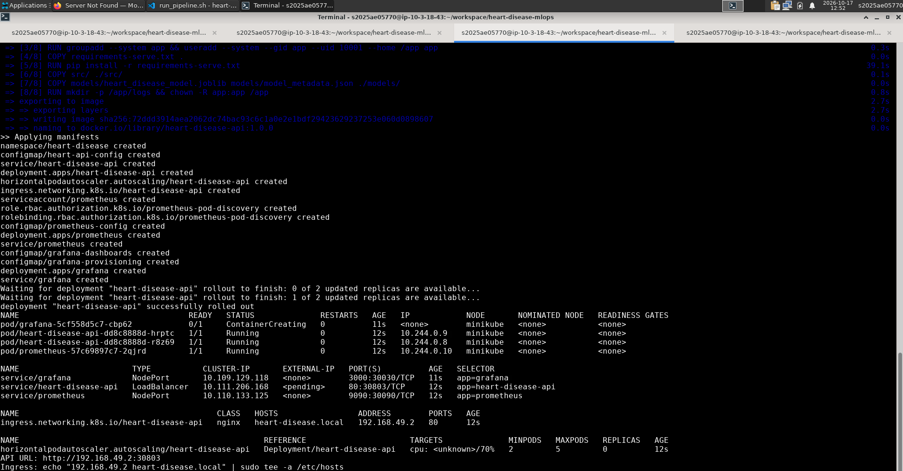
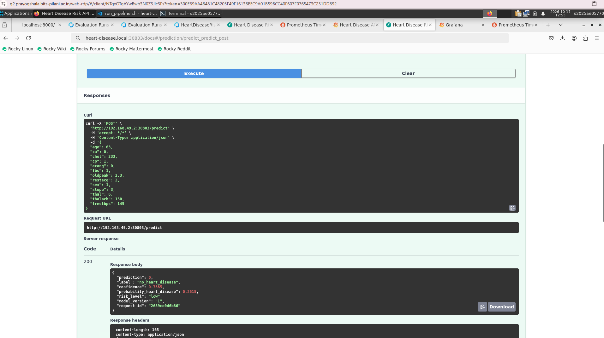

## 10. Monitoring and Logging

**Logging:** each request writes a JSON line with timestamp, request ID, method, path, status, latency and client. Each prediction writes a second JSON line with the validated input, the prediction, the probability and the risk band. Logs go to stdout, where `kubectl logs` and `docker logs` can read them, and to a rotating file at `/app/logs/api.log`. A shared request ID links the request line to its prediction line.

**Metrics** (`src/monitoring/metrics.py`, exposed at `/metrics`):

| Metric | Type |
|---|---|
| `heart_api_requests_total{method,endpoint,status_code}` | Counter |
| `heart_api_request_latency_seconds` | Histogram |
| `heart_api_requests_in_progress` | Gauge |
| `heart_model_predictions_total{label}` | Counter |
| `heart_model_probability` | Histogram |
| `heart_model_prediction_errors_total`, `heart_model_loaded`, `heart_model_info` | Counter, Gauge, Info |

Endpoint labels use the route template rather than the raw path, which keeps label cardinality bounded.

**Dashboard:**

- Prometheus scrapes the pods. Under docker compose it uses a static target; in Kubernetes it uses pod service discovery with namespace-scoped RBAC and the `prometheus.io/*` annotations.
- Grafana is provisioned automatically with a datasource and the **Heart Disease API** dashboard. Its panels show: model loaded, total predictions, request rate, p95 latency, 5xx error ratio, count of validation rejects, requests by endpoint and status, p50/p95/p99 latency, predictions by label, and the share of high-risk predictions over 15 minutes as a simple prediction-drift signal.
- `scripts/generate_traffic.py` replays rows from the cleaned dataset (about 5% deliberately invalid) to populate the dashboard.

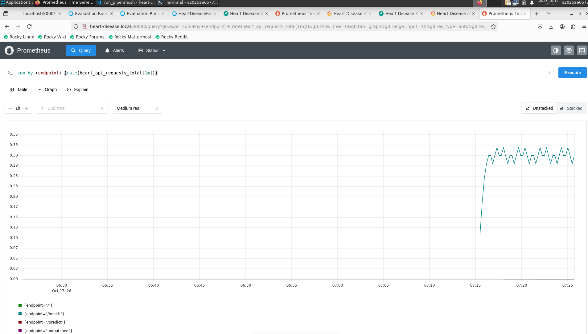
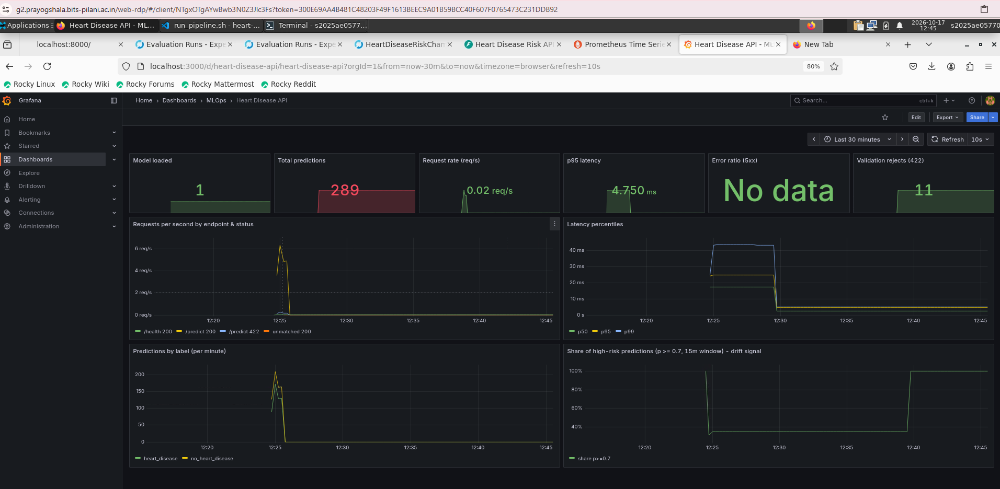

## 11. Conclusions and Future Work

The pipeline is reproducible: the same commands work locally, in Airflow and in CI. It is tested and automated, with every stage gated in GitHub Actions, and the deployment is observable through logs, metrics and a dashboard.

Possible next steps:

- Calibrate the probabilities and choose the decision threshold from a clinical cost of false negatives.
- Add data-drift tests (for example, PSI on the input features) using the logged inputs.
- Add the other three UCI sites (Hungary, Switzerland, VA) as an external validation set.
- Promote models through MLflow aliases (`challenger` to `champion`) with an automated quality gate before deployment.
- Add a Helm chart and a GitOps deployment, such as Argo CD.

## Appendix A: Deliverables Checklist

| Requirement | Location |
|---|---|
| Code, Dockerfile, requirements | `src/`, `Dockerfile`, `docker-compose.yml`, `requirements.txt`, `requirements-serve.txt` |
| Cleaned dataset and download script | `data/processed/heart_disease_clean.csv`, `scripts/download_data.py` |
| Notebooks (EDA, training, inference) | `notebooks/01_eda.ipynb`, `02_model_training.ipynb`, `03_inference.ipynb` |
| Unit tests | `tests/` (44 tests) |
| CI/CD workflow | `.github/workflows/ci.yml` |
| Deployment manifests | `k8s/`, `k8s/monitoring/` |
| Monitoring configuration | `monitoring/` (Prometheus and Grafana provisioning, dashboard JSON) |
| Screenshots | `screenshots/` |
| Report | `reports/Heart_Disease_MLOPS_Report.docx` (submitted), `reports/REPORT.md` |
| Orchestration (as in class) | `dags/heart_disease_pipeline.py` |
